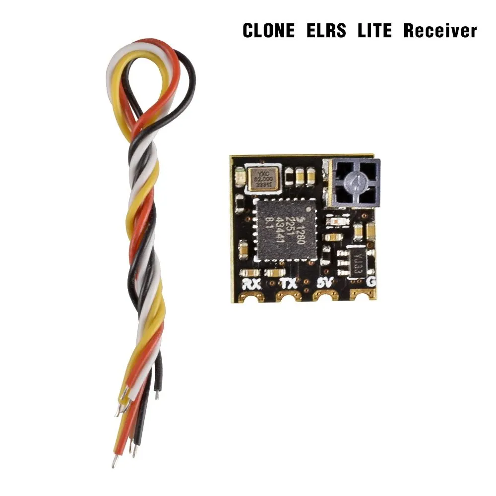
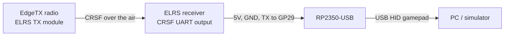

# edgetx-elrs-usb-sim — беспроводной пульт для FPV-симуляторов

[Русский](#русский) · [English](#english)

---

## Русский


Небольшая плата на RP2350 читает каналы ELRS-приёмника по CRSF и отдаёт их компьютеру как обычный USB-геймпад: 4 оси и 8 кнопок. Пульт остаётся беспроводным, кабель идёт только от платы к ПК.

Работает с Liftoff, Velocidrone, DRL Sim, Uncrashed, Tryp FPV, FPV Freerider и другими симуляторами, которые видят DirectInput-джойстик.

### Зачем это нужно

Втыкать USB-кабель в аппаратуру каждый раз неудобно: разъём на пульте изнашивается, кабель мешает на столе. BLE-джойстик убирает кабель, но добавляет заметный лаг.

Проект берёт радиолинк, на котором вы и так летаете, и превращает его в обычный USB-геймпад со стороны ПК. В сам пульт при этом не втыкается ничего.

Что получается в сравнении с готовыми коммерческими свистками:

- поддерживается bind phrase — стандарт ELRS, без которого коммерческие свистки почти бесполезны;
- дешевле и проще достать, чем готовое решение;
- кнопки разводятся через Mixes на каналах 5–12, как удобно в вашей модели;
- подключение моментальное, скрипт запускать не надо;
- лага нет, как и по кабелю.

### Как это работает


Приёмник выдаёт кадры CRSF со скоростью 420 кбит/с. Плата разбирает их и отправляет USB-отчёт: 4 оси (roll, pitch, throttle, yaw) и 8 кнопок из AUX-каналов. Если связи нет дольше 500 мс, кнопки отпускаются, а оси встают в центр.

### Что нужно

| Компонент | Что именно | Комментарий |
|---|---|---|
| Плата | RP2350-USB (RP2350A, 16 МБ flash, USB-A) | Например, [такая](https://www.ozon.ru/product/modul-mini-razrabotki-rp2350a-chip-520kb-rp2350-usb-16mb-flash-s-dvuhyadernym-protsessorom-dlya-3296403212/). Подойдёт любая плата на RP2350 с USB и гребёнкой GPIO |
| Приёмник | Любой ExpressLRS-приёмник с UART-выходом CRSF | На фото — ELRS Lite 2.4 ГГц (SX1280). Главное — площадки `RX`, `TX`, `5V`, `G` и диапазон, совпадающий с модулем пульта |
| Пульт | EdgeTX/OpenTX с ELRS TX-модулем | Внутренний или внешний модуль, 2.4 ГГц или 900 МГц — тот же диапазон, что у приёмника |



### Подключение

| Приёмник | Плата RP2350-USB |
|---|---|
| `5V` | `5V` (VBUS с USB-разъёма) |
| `G` (GND) | `GND` |
| `TX` | `GP29` (площадка 29) |
| `RX` | не подключать |

- **TX приёмника** паяется к **RX платы**. Площадка `RX` приёмника — вход, она не нужна.
- Общий GND обязателен, иначе кадры будут биться.
- Логика у обоих 3.3 В, преобразователи уровней не нужны.
- Питание 5 В плата получает из USB. Если на вашей ревизии нет площадки `5V`, питайте приёмник отдельно, но GND соедините.
- Антенну приёмника не прижимайте к плате и USB-разъёму.

### Прошивка

Файл `edgetx_elrs_usb_sim.uf2` лежит на [странице релизов](https://github.com/voffmail/edgetx-elrs-usb-sim/releases/latest).

1. Отключите плату от USB.
2. Зажмите кнопку **BOOT** (на некоторых платах — BOOT и RST: зажать BOOT, нажать и отпустить RST).
3. Подключите в USB-порт компьютера. После этого отпустите кнопку BOOT. Появится съёмный диск `RP2350` (иногда `RPI-RP2`).
4. Перетащите `edgetx_elrs_usb_sim.uf2` на диск.
5. Плата перезагрузится сама и появится в системе как игровое устройство.

Обновление прошивки — так же, через BOOT.

### Настройка пульта

1. Создайте модель (или возьмите существующую) с ELRS-модулем в том же диапазоне, что приёмник.
2. Забиндите приёмник: по bind phrase в модуле и приёмнике либо кнопкой на приёмнике.
3. В Модели во вкладке Mixes настройте тумблеры и кнопки по каналам 5–12: они станут кнопками джойстика 1–8.
4. Проверьте в мониторе каналов, что каждый тумблер меняет свой канал.

### Раскладка каналов

| Канал ELRS | Роль | В USB |
|---|---|---|
| 1 | Roll | ось X |
| 2 | Pitch | ось Y (инвертируется в прошивке) |
| 3 | Throttle | ось Z |
| 4 | Yaw | ось Rx |
| 5–12 | AUX1–AUX8 | кнопки 1–8 |

### Индикация

Светодиод нужен для быстрой диагностики: видно, есть ли бинд и работает ли линк.

| Состояние | Что видно |
|---|---|
| Потока CRSF нет: приёмник не забинжен, пульт выключен, обрыв связи | синий светодиод плавно разгорается и гаснет, полный цикл 2 с |
| Поток CRSF идёт | ровный зелёный |
| Двигаются стики | частое мигание, пока стики двигаются и ещё 0.3 с после остановки |

### Проверка на компьютере

Windows:

1. Подключите плату с приёмником к ПК.
2. `Win+R` → `joy.cpl` → должно появиться устройство **EdgeTX ELRS USB SIM**.
3. Свойства → «Проверка»: стики ходят, тумблеры зажигают кнопки.
4. В симуляторе выберите это устройство и назначьте оси и кнопки вручную.

Linux: удобнее всего `jstest-gtk`, либо `jstest /dev/input/js0` или `sudo evtest`. Если ничего из этого не установлено, есть свой скрипт:

```bash
python3 tools/jsmon.py
```

Нюансы:

- **Steam Input** может перехватить геймпад: для симулятора в Steam его лучше отключить.
- Симулятор, который понимает только XInput (Xbox-контроллеры), это устройство не увидит. FPV-симуляторы обычно читают DirectInput и работают.
- Windows 10/11 не требует драйверов.

### Если что-то не работает

| Симптом | Что проверить |
|---|---|
| В `joy.cpl` устройства нет | Прошивка записалась? Плата видна в Диспетчере устройств как HID-контроллер? Попробуйте другой USB-порт |
| Устройство есть, оси стоят | Перепутаны TX/RX: `TX` приёмника → `GP29`; общий GND; в приёмнике включён CRSF |
| Оси дёргаются | Плохой контакт, длинные провода, приёмник питается не от 5 В |
| Кнопки не нажимаются | Проверьте каналы 5–12 в мониторе пульта: каждый тумблер должен менять свой канал |
| Тангаж или другие оси инвертированы | Настройте инверсию в симуляторе |
| Симулятор не видит устройство | Отключите Steam Input; проверьте, что игра читает DirectInput, а не только XInput |
| Приёмник не биндится | Это за рамками проекта. Смотрите [документацию ELRS по биндингу](https://www.expresslrs.org/quick-start/binding/) |

Сборка из исходников, настройки в коде и внутреннее устройство — в [develop.md](develop.md).

---

## English


A small RP2350 board reads channels from an ExpressLRS receiver over CRSF and presents them to a computer as a regular USB gamepad: 4 axes and 8 buttons. The radio stays wireless, and the only cable runs from the board to the PC.

Works with Liftoff, Velocidrone, DRL Sim, Uncrashed, Tryp FPV, FPV Freerider and other simulators that see a DirectInput joystick.

### Why this exists

Plugging a USB cable into the radio every time is annoying: the connector wears out and the cable gets in the way. A BLE joystick removes the cable but adds noticeable latency.

This project takes the radio link you already fly with and turns it into a normal USB gamepad on the PC side. Nothing is plugged into the radio.

Compared to ready-made commercial dongles:

- bind phrase is supported — an ELRS standard, and without it commercial dongles are almost useless;
- cheaper, and easier to get than a ready-made device;
- buttons are mapped through Mixes on channels 5–12 in your model;
- connection is instant, no script to run;
- no latency, same as with a cable.

### How it works



The receiver outputs CRSF frames at 420 kbit/s. The board parses them and sends a USB report: 4 axes (roll, pitch, throttle, yaw) and 8 buttons from the AUX channels. If the link is lost for more than 500 ms, all buttons are released and the axes are centered.

### What you need

| Part | What exactly | Notes |
|---|---|---|
| Board | RP2350-USB (RP2350A, 16 MB flash, USB-A) | For example [this one](https://www.ozon.ru/product/modul-mini-razrabotki-rp2350a-chip-520kb-rp2350-usb-16mb-flash-s-dvuhyadernym-protsessorom-dlya-3296403212/). Any RP2350 board with USB and GPIO pads will do |
| Receiver | Any ExpressLRS receiver with a CRSF UART output | The photo shows an ELRS Lite 2.4 GHz (SX1280). Look for `RX`, `TX`, `5V`, `G` pads and the same band as your TX module |
| Radio | EdgeTX/OpenTX radio with an ELRS TX module | Internal or external module, 2.4 GHz or 900 MHz — matching the receiver |


### Wiring

| Receiver | RP2350-USB board |
|---|---|
| `5V` | `5V` (VBUS from the USB plug) |
| `G` (GND) | `GND` |
| `TX` | `GP29` (pad 29) |
| `RX` | leave unconnected |

- Solder the receiver's **TX** to the board's **RX**. The receiver's `RX` pad is an input and is not used.
- Common ground is mandatory, otherwise frames will be corrupted.
- Both sides use 3.3 V logic; no level shifter is needed.
- The board gets 5 V from USB. If your board revision has no `5V` pad, power the receiver separately and keep the grounds connected.
- Keep the receiver antenna away from the board and the USB plug.

### Flashing

`edgetx_elrs_usb_sim.uf2` is on the [releases page](https://github.com/voffmail/edgetx-elrs-usb-sim/releases/latest).

1. Unplug the board from USB.
2. Hold the **BOOT** button (on some boards: hold BOOT, press and release RST).
3. Plug it into the computer. Then release BOOT. A removable drive named `RP2350` (sometimes `RPI-RP2`) appears.
4. Copy `edgetx_elrs_usb_sim.uf2` to the drive.
5. The board reboots by itself and shows up as a game controller.

Firmware updates follow the same procedure.

### Radio setup

1. Create a model (or use an existing one) with an ELRS module on the same band as the receiver.
2. Bind the receiver: via a bind phrase in both the module and the receiver, or with the receiver's bind button.
3. In the model's Mixes tab, assign switches and buttons to channels 5–12; they become joystick buttons 1–8.
4. Check in the channel monitor that each switch drives its channel.

### Channel map

| ELRS channel | Role | USB |
|---|---|---|
| 1 | Roll | X axis |
| 2 | Pitch | Y axis (inverted in firmware) |
| 3 | Throttle | Z axis |
| 4 | Yaw | Rx axis |
| 5–12 | AUX1–AUX8 | buttons 1–8 |

### Status LED

The LED is there for quick diagnostics: you can see whether the receiver is bound and whether the link works.

| State | What you see |
|---|---|
| No CRSF stream: receiver not bound, radio off, link lost | blue LED fades in and out, 2 s per full cycle |
| CRSF stream present | steady green |
| Sticks moving | fast blink while the sticks move and for 0.3 s after they stop |

### Checking on the computer

Windows:

1. Plug the board with the receiver into the PC.
2. `Win+R` → `joy.cpl` → the device **EdgeTX ELRS USB SIM** should appear.
3. Properties → Test: sticks move, switches light up buttons.
4. In the simulator select the device and bind axes and buttons manually.

Linux: `jstest-gtk` is the easiest, or `jstest /dev/input/js0`, or `sudo evtest`. If none of them is installed, use the bundled script:

```bash
python3 tools/jsmon.py
```

Notes:

- **Steam Input** may capture the gamepad. Disable it for the simulator.
- A simulator that only speaks XInput (Xbox controllers) will not see this device. FPV simulators normally use DirectInput and work fine.
- Windows 10/11 need no drivers.

### Troubleshooting

| Symptom | What to check |
|---|---|
| Device absent in `joy.cpl` | Was the firmware flashed? Is the board visible as an HID controller in Device Manager? Try another USB port |
| Device present, axes do not move | TX/RX swapped: receiver `TX` goes to `GP29`; common ground; CRSF selected in the receiver |
| Axes jitter | Bad solder joint, long wires, receiver powered from something other than 5 V |
| Buttons do not work | Check channels 5–12 in the radio's channel monitor: each switch must drive its channel |
| Pitch or another axis is inverted | Set the inversion in the simulator |
| Simulator does not see the device | Disable Steam Input; check that the game reads DirectInput, not XInput only |
| Receiver does not bind | Out of scope here. See the [ELRS binding documentation](https://www.expresslrs.org/quick-start/binding/) |

Building from source, code settings and internals are in [develop.md](develop.md).
