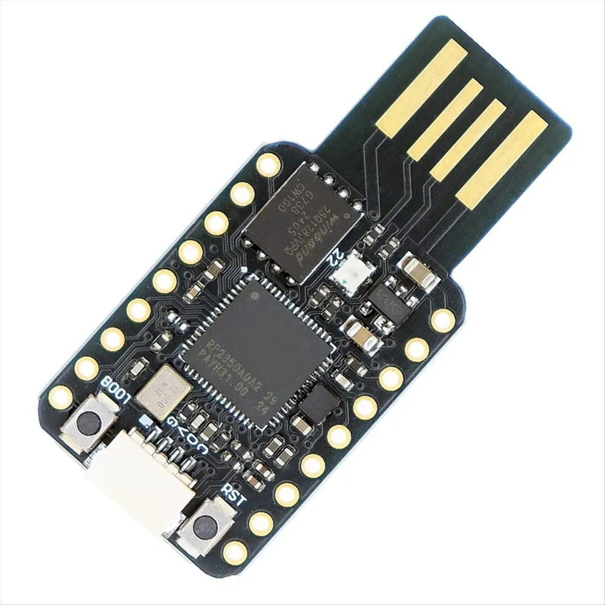
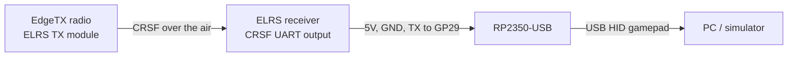

# edgetx-elrs-usb-sim — беспроводной пульт для FPV-симуляторов

[Русский](#русский) · [English](#english)

---

## Русский



Плата читает каналы ELRS-приёмника по протоколу CRSF и отдаёт их компьютеру как обычный USB-геймпад: 4 оси и 12 кнопок. Пульт остаётся беспроводным, кабель идёт только от маленькой платы к ПК. Никаких Bluetooth-донглов, драйверов и Betaflight-полётников.

Подходит для Liftoff, Velocidrone, DRL Sim, Uncrashed, Tryp FPV, FPV Freerider и других симуляторов, которые видят DirectInput-джойстик.

### Зачем это нужно

Постоянно втыкать USB-кабель в аппаратуру — это две реальные проблемы:

- разъём USB на пульте изнашивается и может механически сломаться, а кабель всё время мешает на столе;
- BLE-джойстик убирает кабель, но добавляет заметный лаг управления, который в симуляторе чувствуется сразу.

Проект берёт радиолинк, на котором вы и так летаете, и превращает его в обычный USB-геймпад со стороны ПК. В сам пульт при этом не втыкается ничего.

### Как это работает


Приёмник выдаёт кадры CRSF на скорости 420 кбит/с. Плата разбирает их, берёт 16 каналов и отправляет в USB отчёт: 4 оси (roll, pitch, throttle, yaw) и 12 кнопок из AUX-каналов. Если радиосвязь пропала дольше 500 мс, плата отпускает кнопки и ставит оси в центр.

### Что нужно купить

| Компонент | Что именно | Комментарий |
|---|---|---|
| Плата | RP2350-USB (RP2350A, 16 МБ flash, USB-A) | Например, [такая](https://www.ozon.ru/product/modul-mini-razrabotki-rp2350a-chip-520kb-rp2350-usb-16mb-flash-s-dvuhyadernym-protsessorom-dlya-3296403212/). Подойдёт любая плата на RP2350 с USB и гребёнкой GPIO |
| Приёмник | Любой ExpressLRS-приёмник с UART-выходом CRSF | На фото — ELRS Lite 2.4 ГГц (SX1280). Главное — площадки `RX`, `TX`, `5V`, `G` и диапазон, совпадающий с модулем пульта |
| Пульт | EdgeTX/OpenTX с ELRS TX-модулем | Внутренний или внешний модуль, 2.4 ГГц или 900 МГц — тот же диапазон, что у приёмника |
| Провода | 3 тонких провода | Или штатный 4-проводной кабель приёмника, один провод останется свободным |
| ПК | USB-A порт, Windows 10/11 | Плата вставляется в порт напрямую; если порт неудобный — USB-A удлинитель |


### Схема подключения

| Приёмник | Плата RP2350-USB |
|---|---|
| `5V` | `5V` (VBUS с USB-разъёма) |
| `G` (GND) | `GND` |
| `TX` | `GP29` (UART0 RX) |
| `RX` | не подключать |

Важно:

- Тянем именно **TX приёмника** на **RX платы**. Площадка `RX` приёмника не нужна — это вход, а не выход.
- Общий GND обязателен, иначе кадры будут биться.
- Оба устройства работают с логикой 3.3 В, преобразователи уровней не нужны.
- Питание 5 В плата получает из USB-порта. Если на вашей ревизии платы нет площадки `5V`, питайте приёмник от отдельного 5 В, но GND всё равно соедините.
- Антенну приёмника не прижимайте к плате и USB-разъёму.
- Цвета проводов у клонов произвольные: ориентируйтесь на подписи `RX`, `TX`, `5V`, `G` на плате приёмника, а не на фото.
- Номера на площадках клонов — это номера GPIO: площадка `29` это GP29, `28` — GP28.

Пины по умолчанию заданы в `src/main.c`:

```c
#define CRSF_UART uart0
#define CRSF_RX_PIN 29
#define CRSF_TX_PIN 28
```

Если на вашей плате удобнее другие выводы — поменяйте их. TX-пин не используется, но должен указывать на существующий GPIO.

Подойдёт любой вывод, у которого есть нужный UART: прошивка выбирает функцию через `UART_FUNCSEL_NUM`, включая альтернативную `GPIO_FUNC_UART_AUX`. Учтите, что у RP2350-USB-A и клонов на гребёнку выведены GP0–GP10 и GP26–GP29, а вывод светодиода (GP22 на этой ревизии, GP16 у эталонной платы) наружу не выходит. Из правой группы площадок (26–29) принимать CRSF умеет только **GP29**: `GP26`, `GP27`, `GP28` дают UART только на передачу (или через альтернативную функцию), а `GP28` — это UART0 TX. Поэтому по умолчанию RX = GP29, а GP28 указан как неиспользуемый TX.

### Прошивка

Готовый файл: раздел **Releases** в этом репозитории, `edgetx_elrs_usb_sim.uf2`. Либо возьмите артефакт из последнего запуска GitHub Actions.

1. Отключите плату от USB.
2. Зажмите кнопку **BOOT** (на некоторых платах — BOOT и RST: зажать BOOT, нажать и отпустить RST).
3. Подключите USB. Появится съёмный диск `RP2350` (иногда `RPI-RP2`).
4. Перетащите `edgetx_elrs_usb_sim.uf2` на диск.
5. Плата перезагрузится сама и появится в системе как игровое устройство.

Обновление прошивки — так же, через BOOT.

### Сборка из исходников

Нужен только Git и интернет. Всё остальное скрипт скачает **внутрь проекта**, в папку `.toolchain`, без прав администратора и без изменения системного PATH. Повторные сборки ничего не скачивают.

Windows (PowerShell):

```powershell
git clone <адрес-репозитория>
cd edgetx-elrs-usb-sim
powershell -ExecutionPolicy Bypass -File tools\build.ps1
```

Скрипт скачает ARM GCC, CMake, Ninja, Python, Pico SDK, соберёт прошивку и положит готовый файл в корень проекта: `edgetx_elrs_usb_sim.uf2`.

Полезные параметры:

```powershell
# пересобрать с нуля
powershell -ExecutionPolicy Bypass -File tools\build.ps1 -Clean

# другая плата (например, RP2040)
powershell -ExecutionPolicy Bypass -File tools\build.ps1 -Board pico
```

Linux x86_64:

```bash
git clone <адрес-репозитория>
cd edgetx-elrs-usb-sim
bash tools/build.sh
```

Скрипт сам скачает GCC/CMake/Ninja и Pico SDK в `.toolchain`. Нужны системные `git`, `curl`, `python3`. На macOS и других архитектурах поставьте пакеты системно (`brew install cmake ninja` и ARM-тулчейн), затем выполните `cmake` вручную либо используйте артефакт CI.

CI: `.github/workflows/build.yml` собирает прошивку на каждый push и PR, а по тегу `v*` прикладывает UF2 к релизу.

### Настройка пульта

1. В EdgeTX создайте модель (или возьмите существующую) с ELRS-модулем в том же диапазоне, что приёмник.
2. Забиндите приёмник: по bind phrase в модуле и приёмнике либо кнопкой на приёмнике.
3. Убедитесь, что порядок каналов в модели — **AETR**: 1 — roll, 2 — pitch, 3 — throttle, 4 — yaw. Это дефолт EdgeTX.
4. Разложите тумблеры и кнопки по каналам 5–16: они станут кнопками 1–12 в USB-отчёте.
5. Проверьте в меню каналов, что каждый тумблер реально меняет свой канал (около 1000 и 2000 мкс).

### Раскладка каналов

| Канал ELRS | Роль | В USB |
|---|---|---|
| 1 | Roll | ось X |
| 2 | Pitch | ось Y (инвертируется в прошивке) |
| 3 | Throttle | ось Z |
| 4 | Yaw | ось Rx |
| 5–16 | AUX1–AUX12 | кнопки 1–12 |

Кнопка считается нажатой, когда канал выше центра на 150 мкс, и отпускается ниже центра на 50 мкс — так тумблеры не дребезжат на границе.

### Индикация

На плате стоит адресный светодиод WS2812: на этой ревизии он подключён к `GP22`, у эталонной RP2350-USB-A — к `GP16`. Прошивка показывает им состояние радиолинка:

| Состояние | Что видно |
|---|---|
| Потока CRSF нет: приёмник не забинжен, пульт выключен, обрыв связи | синий светодиод плавно разгорается и гаснет, полный цикл 2 с |
| Поток CRSF идёт | ровный зелёный |
| Двигаются стики | частое мигание, пока стики двигаются и ещё 0.3 с после остановки |

Если на вашей ревизии платы светодиод подключён к другому выводу, поменяйте `LED_PIN` в `src/led.h`. Яркость и цвета — константы `FADE_MAX_LEVEL`, `LINK_*`, `BLINK_*` в `src/led.c`; там же порог реакции на движение стика (`MOVE_DELTA`) и время удержания мигания (`MOVE_HOLD_MS`).

### Windows и симулятор

1. Подключите плату с приёмником к ПК.
2. `Win+R` → `joy.cpl` → должно появиться устройство **EdgeTX ELRS USB SIM**.
3. Свойства → «Проверка»: стики ходят, тумблеры зажигают кнопки.
4. В симуляторе выберите это устройство и назначьте оси и кнопки вручную.

Нюансы:

- **Steam Input** может перехватить геймпад: для симулятора в Steam его лучше отключить.
- Симулятор, который понимает только XInput (Xbox-контроллеры), это устройство не увидит. FPV-симуляторы обычно читают DirectInput и работают.
- Windows 10/11 не требуют драйверов. Windows 7 — отдельная история, лучше не использовать.

### Если что-то не работает

| Симптом | Что проверить |
|---|---|
| В `joy.cpl` устройства нет | Прошивка записалась? Плата видна в Диспетчере устройств как HID-контроллер? Попробуйте другой USB-порт |
| Устройство есть, оси стоят | Перепутаны TX/RX: `TX` приёмника → `GP29`; общий GND; в приёмнике включён CRSF |
| Оси дёргаются | Плохой контакт, длинные провода, приёмник питается не от 5 В |
| Все кнопки всегда нажаты | Каналы AUX стоят в максимуме или перепутаны каналы в модели |
| Тангаж в симуляторе наоборот | Так и задумано (инверсия pitch). Уберите минус в `report->y` в `src/main.c`, если нужно иначе |
| Симулятор не видит устройство | Отключите Steam Input; проверьте, что игра читает DirectInput, а не только XInput |
| Приёмник не биндится | Диапазон и протокол модуля и приёмника должны совпадать; проверьте bind phrase |

### Настройки в коде

- Пины UART — `src/main.c`, константы `CRSF_UART`, `CRSF_RX_PIN`, `CRSF_TX_PIN`.
- Порядок каналов — `CH_ROLL`, `CH_PITCH`, `CH_THROTTLE`, `CH_YAW`.
- Пороги кнопок — `BUTTON_PRESS_OFFSET`, `BUTTON_RELEASE_OFFSET`.
- USB-дескриптор, 4 оси и 12 кнопок — `src/usb_descriptors.c`.
- Таймаут связи и разбор CRSF — `src/crsf.c`.
- Индикация: пин светодиода — `LED_PIN` в `src/led.h`, цвета и тайминги — `src/led.c`.

### Структура репозитория

```
.
├── CMakeLists.txt              сборка прошивки
├── tusb_config.h               настройки TinyUSB
├── src/
│   ├── main.c                  раскладка каналов, кнопки, failsafe
│   ├── crsf.c / crsf.h         UART, CRC, разбор кадров CRSF
│   ├── led.c / led.h           индикация на WS2812
│   ├── ws2812.pio              PIO-программа для WS2812
│   └── usb_descriptors.c/.h    USB HID: 4 оси + 12 кнопок
├── tools/
│   ├── setup-toolchain.ps1     локальный тулчейн для Windows
│   ├── build.ps1               сборка одной командой
│   ├── setup-toolchain.sh      то же для Linux x86_64
│   ├── build.sh
│   └── bin2uf2.py              UF2 без picotool
├── docs/                       фото платы и приёмника
└── .github/workflows/build.yml сборка в CI и релиз по тегу
```

### Ограничения

- Только приёмники с выходом **CRSF**; SBUS/PWM не поддерживаются.
- Жёстко заданы 4 оси и 12 кнопок. Дополнительные крутилки как оси не выводятся — только кнопками.
- Телеметрия CRSF (уровень сигнала) не передаётся в ПК.
- USB у RP2350 — Full Speed, поллинг 1 мс. Для джойстика этого достаточно.
- Прошивка собрана и проверена на уровне сборки и формата UF2, но на реальном железе пока не запускалась. Если что-то не работает — issue или PR приветствуются.

---

## English


The board reads channel data from an ExpressLRS receiver over CRSF and presents it to a computer as an ordinary USB gamepad: 4 axes and 12 buttons. The radio stays wireless, the only cable goes from a tiny board to the PC. No Bluetooth dongles, no drivers, no Betaflight flight controller.

Works with Liftoff, Velocidrone, DRL Sim, Uncrashed, Tryp FPV, FPV Freerider and any other simulator that accepts a DirectInput joystick.

### Why this exists

Plugging a USB cable into the radio every time has two real problems:

- the USB connector on the radio wears out and can be broken mechanically, and the cable constantly gets in the way on the desk;
- a BLE joystick removes the cable but adds noticeable control latency, which is exactly what you feel in a simulator.

This project keeps the radio link you already fly with and turns it into a normal USB gamepad on the PC side. Nothing is plugged into the radio at all.

### How it works



The receiver outputs CRSF frames at 420 kbit/s. The board parses them, takes 16 channels and sends a USB report: 4 axes (roll, pitch, throttle, yaw) and 12 buttons derived from the AUX channels. If the radio link is lost for more than 500 ms, the board releases all buttons and centers the axes.

### What to buy

| Part | What exactly | Notes |
|---|---|---|
| Board | RP2350-USB (RP2350A, 16 MB flash, USB-A) | For example [this one](https://www.ozon.ru/product/modul-mini-razrabotki-rp2350a-chip-520kb-rp2350-usb-16mb-flash-s-dvuhyadernym-protsessorom-dlya-3296403212/). Any RP2350 board with USB and GPIO pads will do |
| Receiver | Any ExpressLRS receiver with a CRSF UART output | The photo shows an ELRS Lite 2.4 GHz (SX1280). Look for `RX`, `TX`, `5V`, `G` pads and the same band as your TX module |
| Radio | EdgeTX/OpenTX radio with an ELRS TX module | Internal or external module, 2.4 GHz or 900 MHz — matching the receiver |
| Wires | 3 thin wires | Or the receiver's stock 4-wire cable, one wire stays unused |
| PC | USB-A port, Windows 10/11 | The board plugs directly into the port; use a USB-A extension if the port is hard to reach |


### Wiring

| Receiver | RP2350-USB board |
|---|---|
| `5V` | `5V` (VBUS from the USB plug) |
| `G` (GND) | `GND` |
| `TX` | `GP29` (UART0 RX) |
| `RX` | leave unconnected |

Notes:

- Connect the receiver's **TX** to the board's **RX**. The receiver's `RX` pad is an input and is not used.
- Common ground is mandatory, otherwise frames will be corrupted.
- Both sides use 3.3 V logic; no level shifter is needed.
- The board gets 5 V from the USB port. If your board revision has no `5V` pad, power the receiver from an external 5 V source and keep the grounds connected.
- Keep the receiver antenna away from the board and the USB plug.
- Wire colors on clones are arbitrary. Follow the `RX`, `TX`, `5V`, `G` labels on the receiver, not the photo.
- The numbers printed next to the pads on clones are GPIO numbers: pad `29` is GP29, `28` is GP28.

Default pins are set in `src/main.c`:

```c
#define CRSF_UART uart0
#define CRSF_RX_PIN 29
#define CRSF_TX_PIN 28
```

Change them if other pins are more convenient on your board. The TX pin is unused but must point to a valid GPIO.

Any pin with the right UART function works: the firmware picks the function via `UART_FUNCSEL_NUM`, including the alternate `GPIO_FUNC_UART_AUX`. Note that RP2350-USB-A and its clones only bring out GP0–GP10 and GP26–GP29, and the LED pin (GP22 on this revision, GP16 on the reference board) is not exposed. In the 26–29 group only **GP29** can receive CRSF: `GP26`, `GP27` and `GP28` only provide UART transmit (or require the alternate function), and `GP28` is UART0 TX. That is why RX defaults to GP29 and GP28 is listed as the unused TX.

### Flashing

Ready binary: see the **Releases** section of this repository, `edgetx_elrs_usb_sim.uf2`. Alternatively download the artifact from the latest GitHub Actions run.

1. Unplug the board from USB.
2. Hold the **BOOT** button (on some boards: hold BOOT, press and release RST).
3. Plug in USB. A removable drive named `RP2350` (sometimes `RPI-RP2`) appears.
4. Copy `edgetx_elrs_usb_sim.uf2` to the drive.
5. The board reboots by itself and shows up as a game controller.

Firmware updates follow the same procedure.

### Building from source

All you need is Git and internet access. The scripts download everything **into the project**, into the `.toolchain` folder, with no admin rights and no changes to the system PATH. Later builds download nothing.

Windows (PowerShell):

```powershell
git clone <repository-url>
cd edgetx-elrs-usb-sim
powershell -ExecutionPolicy Bypass -File tools\build.ps1
```

The script downloads ARM GCC, CMake, Ninja, Python and the Pico SDK, builds the firmware and puts the result in the project root: `edgetx_elrs_usb_sim.uf2`.

Options:

```powershell
# rebuild from scratch
powershell -ExecutionPolicy Bypass -File tools\build.ps1 -Clean

# another board (for example RP2040)
powershell -ExecutionPolicy Bypass -File tools\build.ps1 -Board pico
```

Linux x86_64:

```bash
git clone <repository-url>
cd edgetx-elrs-usb-sim
bash tools/build.sh
```

The script downloads GCC, CMake, Ninja and the Pico SDK into `.toolchain`. Requires `git`, `curl` and `python3`. On macOS or other architectures install the packages system-wide (`brew install cmake ninja`, plus an ARM toolchain) and run CMake manually, or use the CI artifact.

CI: `.github/workflows/build.yml` builds the firmware on every push and pull request, and attaches the UF2 to a release when a `v*` tag is pushed.

### Radio setup

1. In EdgeTX create a model (or use an existing one) with an ELRS module on the same band as the receiver.
2. Bind the receiver: via a bind phrase in both the module and the receiver, or with the receiver's bind button.
3. Make sure the channel order in the model is **AETR**: 1 — roll, 2 — pitch, 3 — throttle, 4 — yaw. This is the EdgeTX default.
4. Assign switches and buttons to channels 5–16; they become buttons 1–12 in the USB report.
5. Check in the channel monitor that each switch actually drives its channel (around 1000 and 2000 µs).

### Channel map

| ELRS channel | Role | USB |
|---|---|---|
| 1 | Roll | X axis |
| 2 | Pitch | Y axis (inverted in firmware) |
| 3 | Throttle | Z axis |
| 4 | Yaw | Rx axis |
| 5–16 | AUX1–AUX12 | buttons 1–12 |

A button is pressed when its channel is 150 µs above center and released when it drops 50 µs below center, so switches do not chatter at the threshold.

### Status LED

The board has an addressable WS2812 LED: on this revision it is wired to `GP22`, on the RP2350-USB-A reference board it is `GP16`. The firmware reports the link state with it:

| State | What you see |
|---|---|
| No CRSF stream: receiver not bound, radio off, link lost | blue LED fades in and out, 2 s per full cycle |
| CRSF stream present | steady green |
| Sticks moving | fast blink while the sticks move and for 0.3 s after they stop |

If your board revision wires the LED to another pin, change `LED_PIN` in `src/led.h`. Brightness and colors are the `FADE_MAX_LEVEL`, `LINK_*` and `BLINK_*` constants in `src/led.c`, which also holds the movement threshold (`MOVE_DELTA`) and the blink hold time (`MOVE_HOLD_MS`).

### Windows and simulator

1. Plug the board with the receiver into the PC.
2. `Win+R` → `joy.cpl` → the device **EdgeTX ELRS USB SIM** should appear.
3. Properties → Test: sticks move, switches light up buttons.
4. In the simulator select the device and bind axes and buttons manually.

Notes:

- **Steam Input** may capture the gamepad. Disable it for the simulator.
- A simulator that only speaks XInput (Xbox controllers) will not see this device. FPV simulators normally use DirectInput and work fine.
- Windows 10/11 need no drivers. Windows 7 is a different story and is not recommended.

### Troubleshooting

| Symptom | What to check |
|---|---|
| Device absent in `joy.cpl` | Was the firmware actually flashed? Is the board visible as an HID controller in Device Manager? Try another USB port |
| Device present, axes do not move | TX/RX swapped: receiver `TX` goes to `GP29`; common ground; CRSF selected in the receiver |
| Axes jitter | Bad solder joint, long wires, receiver powered from something other than 5 V |
| All buttons always pressed | AUX channels are at maximum, or channels are mapped wrong in the model |
| Pitch works backwards in the sim | This is intentional (pitch inversion). Remove the minus in `report->y` in `src/main.c` if you need it the other way |
| Simulator does not see the device | Disable Steam Input; check that the game reads DirectInput, not XInput only |
| Receiver does not bind | TX module and receiver must use the same band and protocol; check the bind phrase |

### Code settings

- UART pins — `src/main.c`, constants `CRSF_UART`, `CRSF_RX_PIN`, `CRSF_TX_PIN`.
- Channel order — `CH_ROLL`, `CH_PITCH`, `CH_THROTTLE`, `CH_YAW`.
- Button thresholds — `BUTTON_PRESS_OFFSET`, `BUTTON_RELEASE_OFFSET`.
- USB descriptor, 4 axes and 12 buttons — `src/usb_descriptors.c`.
- Link timeout and CRSF parsing — `src/crsf.c`.
- Status LED: pin — `LED_PIN` in `src/led.h`, colors and timings — `src/led.c`.

### Repository layout

```
.
├── CMakeLists.txt              firmware build
├── tusb_config.h               TinyUSB configuration
├── src/
│   ├── main.c                  channel mapping, buttons, failsafe
│   ├── crsf.c / crsf.h         UART, CRC, CRSF frame parsing
│   ├── led.c / led.h           WS2812 status indication
│   ├── ws2812.pio              PIO program for the WS2812 LED
│   └── usb_descriptors.c/.h    USB HID: 4 axes + 12 buttons
├── tools/
│   ├── setup-toolchain.ps1     local toolchain for Windows
│   ├── build.ps1               one-command build
│   ├── setup-toolchain.sh      same for Linux x86_64
│   ├── build.sh
│   └── bin2uf2.py              UF2 without picotool
├── docs/                       board and receiver photos
└── .github/workflows/build.yml CI build and tag releases
```

### Limitations

- CRSF receivers only; SBUS and PWM are not supported.
- The report is fixed at 4 axes and 12 buttons. Extra knobs are exposed as buttons, not axes.
- CRSF telemetry (link quality) is not forwarded to the PC.
- RP2350 USB is Full Speed with 1 ms polling, which is plenty for a gamepad.
- The firmware builds and the UF2 format is verified, but it has not been tested on real hardware yet. Issues and pull requests are welcome.
